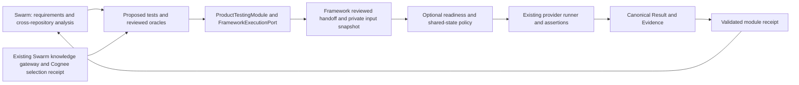

# Swarm product-testing module

This slice supplies a replaceable Swarm product-testing module and a reviewed-input path into the **existing** Auto Regression Test Framework 0.3.2. It is an offline, local verification capability. It does not install itself into the dirty Swarm checkout or claim a live Cognee/SIT deployment.



## Implemented boundary

The module lives in [`integrations/swarm-product-test`](../../integrations/swarm-product-test/). It has its own request/receipt contract and an injected framework execution port, with exact module ID/version discovery for replacement JARs. The isolated `FdiApplication` overlay adds a narrow early CLI hook. Swarm has no pre-existing generic plugin loader in the inspected source; this change does not invent one or reuse Multica-specific execution IDs.

Swarm remains responsible for requirements, cross-repository impact, test proposals, review decisions and interpretation of returned evidence. The module exports a validated receipt for those existing activities. No new autonomous model loop runs here, and the quality or availability of AI analysis is not tested. The framework retains test steps, providers, assertions, status aggregation, canonical reporting and evidence validation. Process completion or exit zero cannot produce successful verification without validated framework artifacts. The module returns its own `ProductTestReceipt`; existing Swarm review/control may derive a separate `VerificationResult`. That conversion is not implemented here. The module does not modify `WorkItemResult`, Human DONE or mission closure.

| Dimension | Implemented | Extension targets / validation gap |
| --- | --- | --- |
| Test level | component; one bounded native HTTP read, CLI command, NATS publish/echo or leased gRPC unary | system, acceptance and broader integration workflows |
| Test type | regression | performance, security and other types |
| Environment stage | local | SIT, preproduction, production |
| Provider | simulated `sample_fake_provider.v0.3`; native loopback `rest_client.v0.3` direct argv `cli_process.v0.3`, owned loopback `nats.v0.3`, or leased loopback `grpc_client.v0.3` for the finite integration slice | other audited real providers |
| Knowledge mode | `not_used`; component tests also support `required` with a pinned existing-format selection receipt | deployed Cognee identity and company source governance |
| Shared state | optional synthetic store shared by callers in one JVM | cross-process/distributed ownership and real SIT enforcement |

Every unsupported tuple blocks. An environment name does not establish a test level, and changing a label cannot turn a fake run into SIT evidence. All delivered examples are `framework_verification_only` with `downstream_release_evidence: false`. Before launch, the module compares the request tuple with the digest-verified reviewed profile; canonical provenance and result binding retain the actual tuple.

## Native leased local gRPC integration

`grpc_client.v0.3` supports one `unary_call` through the existing native gRPC adapter/runtime. This reviewed route accepts only two finite profiles: `echo.v1` (`swarm.producttest.EchoService/Echo`, string `message=1` request/reply), and `greeter.v1` (`helloworld.Greeter/SayHello`, request string `name=1` exactly `swarm-probe`, response string `message=1`). Bind exactly literal `target: grpc://127.0.0.1:<port>` and `owner_run_id` containing 32 lowercase hex characters. The descriptor is a strict base64 `FileDescriptorSet` with one self-contained proto3 file, one service, one unary method and the two exact request/reply messages. Imports, streaming, metadata, reflection, arbitrary services, TLS/auth/authority overrides and unknown inputs/bindings are rejected. The public Greeter profile accepts its exact known Go/Java file options. Generic gRPC suites outside reviewed execution retain their existing behavior.

Inputs are exactly `grpc.service`, `grpc.method`, `grpc.descriptor_ref`, `grpc.message`, with optional `grpc.timeout`. Fixed reviewed fixture paths are `fixtures/echo.desc.b64` or `fixtures/greeter.desc.b64`, `fixtures/request.json` and `fixtures/lease.json`. Encoded descriptors are at most 350 KiB, decoded descriptors at most 256 KiB, and strict UTF-8 request JSON at most 64 KiB. All bytes belong to the reviewed closure. Assertions may refer only to `response.message`, `response.status` and `response.duration_ms`; JSON response oracles remain separate pinned artifacts.

The owner emits its endpoint, random run ID, actual OS PID and process start instant, with `-Dswarm.grpc.owner_nonce=<run ID>` present in its real process arguments. A `reviewed-grpc-lease.v1` lease binds these identities, profile, issue/expiry (at most ten minutes), encoded descriptor SHA-256 and request SHA-256. Preparation performs structural packaging and remains `prepared_not_approved`. Protected execution independently receives `SWARM_PRODUCT_TEST_FIXTURE_LEASE_SHA256` in the module deployment binding and forwards `REGRESS_REVIEWED_FIXTURE_LEASE_SHA256` to the framework. An editable module request cannot provide this pin. Invocation verifies the independently pinned lease and live owner identity; the frozen snapshot's lease is validated again immediately before the actual RPC. There is no listener network preflight, so an alive owner with a stopped listener causes a real provider attempt and `UNAVAILABLE`.

The whole reviewed RPC budget is 1 ms through 5 seconds, including descriptor/request work and response serialization. The channel limits inbound bytes to 1 MiB; serialized response JSON is limited to 1 MiB before assertion/evidence; provider evidence is limited to 2 MiB. Channel shutdown has a separate checked two-second termination bound. Unconfirmed cleanup cannot produce a passed operation. Module metadata and request parsing retain their existing 2 MiB file and 262144-character string limits. Only a digest-bound reviewed gRPC contract selects the payload reader: canonical result JSON is at most 8 MiB with strings at most 1 MiB, and unary proof JSON is at most 2 MiB with the same string bound. The larger tree allowance applies only to the exact canonical `result.json`; other evidence files remain at most 4 MiB, with a 64 MiB total tree bound. This accounts for the canonical result repeating an admitted response in step and provider outputs. Evidence records actual RPC attempts separately from independent fixture server receipts; neither count alone establishes the assertion verdict. Fixture cleanup, PID reap and final closed-port checks belong to the owning local harness.

Use `integrations/swarm-product-test/scripts/grpc-native.py` with an independently supplied lease pin, frozen oracle JSON and optional strict `--review-metadata-file` containing actual source/review facts. It prepares the fixed suite and invokes the existing packaged module smoke path, optionally through the exact compiled host overlay. `GrpcEchoOwner` is a separate JVM TCP protocol fixture; its success is not public-product coverage. Public Greeter acceptance additionally requires the pinned upstream source/license, the owned loopback/receipt patch, actual product runtime receipts, module canonical verdict and verified cleanup. TLS/auth, remote SIT and native Swarm agent adoption remain unverified.

This extends the existing gTAA mapping: reviewed finite descriptors/requests/oracles are test definition, the existing runner/assertions provide execution, and the native adapter is SUT adaptation. The owner harness supplies test data and lifecycle evidence. Swarm's independent review and source-to-effective mapping retain authority; prepared hashes, generated fixtures and module receipts do not establish a loaded agent Skill or a company release decision.

## Native local NATS integration

`nats.v0.3` supports one reviewed `nats_publish` through the existing native wire-protocol runtime. Bind exactly `connection.uri: nats://127.0.0.1:<port>` and an owned `sit.<32 lowercase hex>.echo` subject. Use the fixed reviewed `artifact://fixtures/payload.json` JSON object (at most 65536 UTF-8 bytes); the handoff includes its fixture digest. The operation timeout is 1 ms to 5 seconds, default 5 seconds. Assertions use typed `step://<id>/published` (boolean) and `step://<id>/subject` (string) outputs.

The runtime subscribes before publishing and requires the same subject, subscription ID and byte-exact payload in a correctly framed `MSG`. PONG, EOF, malformed or oversized frames and missing/mismatched echo cannot establish publish success. The native exchange has a whole socket deadline. This is a disposable local broker capability; it does not assert distributed ownership or enable shared SIT messaging. Canonical evidence retains the actual `nats`/`native` identity and framework verdict.

See [public NATS reproduction](../../scripts/public-projects/NATS.md) and [CI/CD integration](ci-cd-product-tests.md). Local CI uses an explicitly reviewed `local-ci-policy`; it is separate from protected CD deployment approval. The module still rejects SIT. The CD hook invokes the existing framework/readiness SPI directly for its documented finite native REST subset.

## Native CLI integration

`cli_process.v0.3` adds direct executable/argv execution through the existing v0.3 provider registry. The reviewed contract selects CLI, HTTP, NATS or gRPC explicitly; the test-level label alone never determines the protocol. One CLI invocation may assert `exit_code`, `stdout`, `stderr` and `duration_ms`. A normal nonzero exit can satisfy a negative test; launch failure, timeout, excess output, invalid UTF-8 or incomplete known-process cleanup cannot pass.

The executable is pinned by an absolute path and SHA-256, stdin and argv are literal reviewed inputs, and cwd is created under the owned run directory. Environment is cleared except fixed C locale. This is a trusted local executable boundary, not a process sandbox or a claim of shared-SIT read-only access. See [CLI contract, bounds and example](reviewed_cli_process.md) and [reviewed implementation plan](../04-planning/reviewed-cli-provider.md). The existing ISTQB mapping also applies: provider adaptation, canonical framework verdicts, independently reviewed oracles and evidence-based AI analysis.

## Native loopback integration read

The `integration/regression/local` capability uses the existing native REST adapter, HTTP runtime, assertions and canonical reporting. It permits exactly one GET or HEAD across one leaf suite, with one target bound to literal `http://127.0.0.1:<port>`. A static absolute path may contain a reviewed literal query as specified below, with an optional timeout of 1 ms through 10 seconds. DNS hosts, user information, query/fragment origins, request bodies, custom headers, write methods, dynamic inputs, HTTP setup/cleanup, readiness and shared-state policy are rejected. The native provider declares `real`; the component fake provider remains `simulated`.

### Reviewed query targets

`request.path` binds the complete raw target, for example `/articles?views:gt=10&_sort=-views&_page=1&_per_page=1`. The provider sends those exact reviewed bytes. Changing a query or path after approval invalidates the handoff before any HTTP request.

The target is at most 2,048 ASCII characters. The existing path grammar and normalization rules remain unchanged. A query contains 1..32 `key=value` pairs separated by `&`, with exactly one literal `=` per pair and no empty pairs. Percent escapes must decode once as valid UTF-8; `+` means space for validation. Decoded keys use 1..128 characters from `[A-Za-z0-9_.:-]`; decoded values use 0..512 ASCII letters, digits, spaces or `_ . , : + ~ -`. Empty values are allowed. Duplicate decoded keys are rejected case-sensitively. Encoded delimiters, nested escapes, control characters, Unicode values, fragments and templates are outside this capability.

Key names are compared case-insensitively after removing `.`, `_`, `:`, `-`: names containing `password`, `passwd`, `token`, `secret`, `authorization`, `credential`, `apikey`, `session`, `cookie`, `connection`, or equal to `auth`/`pwd` are rejected. This conservative filter does not establish that arbitrary literal content is non-sensitive; reviewers must exclude secrets from query values. Preparation, adapter validation and runtime share the same policy. The ordinary REST provider outside the reviewed module retains its existing behavior.

The HTTP client never follows redirects, and reviewed 3xx responses fail. A bounded response subscriber cancels before copying bytes beyond 1 MiB. A single reviewed request deadline covers headers and complete body consumption; timeout or interruption cancels the pending response and subscriber, and a late body cannot produce PASS. The independently bounded module invocation still governs total runtime. JSON collection oracles use the existing `json_match` assertion with a pinned static `expected_ref`. A wrong expected value produces the framework's assertion failure; a transport success is not a test verdict.

Prepare native fixtures in the existing v0.3 layout, such as `env_profiles/local_native.yaml` and `test_cases/native.yaml`. The repository's REST contract uses YAML aliases. Reviewed inputs intentionally reject aliases, so resolve that trusted source contract once into equivalent literal JSON (valid YAML), save it under the suite's `contracts/` directory, and pin those exact bytes in the reviewed handoff. Keep the canonical source contract unchanged and retain its source identity in preparation evidence; do not relax strict snapshot parsing.

Application setup, isolated fixture writes, lifecycle and exact-ID cleanup belong to the local project harness, outside this read-only provider slice. The fake ownership store grants no rights over application data. One HTTP operation avoids overwriting the current REST provider's fixed request/response evidence paths; multi-request reviewed workflows remain unsupported. Public-project source/service evidence must establish which real services ran. Native HTTP alone does not prove application identity, complete product coverage or company acceptance. New continuation evidence lives in the task's `evidence-public-project/` directory; the immutable v2 delivery remains in `evidence-v2/`.

## Reviewed inputs and preparation

`product_test` is optional in a v0.3 environment profile. Ordinary invocations preserve compatibility only when the policy, `REGRESS_REVIEWED_HANDOFF_SHA256` and `REGRESS_REVIEWED_FIXTURE_LEASE_SHA256` are all absent. A present pin, including an empty or malformed value, requires the reviewed path at common dispatch. Legacy/package/group routes cannot consume it; use one reviewed v0.3 leaf per invocation. Embedded callers have the same check through `V03RuntimeExecutionService.runReviewed`, and normal runtime entry points honor the digest captured from their invocation environment.

The handoff binds the exact suite/profile, workspace/project scope, repository revisions, reviewed test/oracle mapping, framework baseline and raw bytes of all supported executable inputs and provider contracts. `prepare-product-test-handoff` hashes already supplied review facts and writes a candidate handoff plus `.sha256`; it reports **prepared, not approved**. A trusted caller supplies the approved digest independently when running. The Swarm module takes that approval pin from protected invocation configuration, compares it with the request and pinned handoff, and passes the configuration value to the framework; an editable request cannot self-approve a changed handoff. The digest is an integrity anchor, not authentication, approval or a guarantee that the oracle is correct.

```sh
java -jar target/spec-driven-auto-regression-0.3.2.jar \
  prepare-product-test-handoff \
  --suite samples/41-product-testing/reviewed_local/suite_manifest.yaml \
  --profile local_v03 \
  --review-input samples/41-product-testing/reviewed_local/review-input.json \
  --out samples/41-product-testing/reviewed_local/handoff/reviewed-tests.json

REGRESS_REVIEWED_HANDOFF_SHA256='<independently approved raw-byte digest>' \
java -jar target/spec-driven-auto-regression-0.3.2.jar run \
  --suite samples/41-product-testing/reviewed_local/suite_manifest.yaml \
  --profile local_v03
```

Required knowledge uses the existing Dev204 shape: `context.selected`, `context.excluded` and `cogneeSelection.candidateSearch.candidates`. Used candidates must exactly join governed selected records on source/revision/provider/source-ref/scope/content identities and the reviewed test mapping. Candidate-only, excluded, ambiguous or expired selected entries block. Both handoff expiry and used selected-record `validUntil` are checked at invocation; equality with current time is expired. This uses the local UTC clock. The importer does not reproduce Swarm governance/replay, fetch sources, contact Cognee, or turn expected source version 1.6.2 into verified server identity. Synthetic receipts remain synthetic. Local `not_used` tests require neither a Cognee receipt nor Cognee source-version metadata.

The runtime reads each accepted input into bounded bytes, verifies its hash and materializes those same bytes into one private snapshot. It accepts the known static fake-provider graph or a finite native HTTP read, CLI command, NATS publish/echo or leased gRPC unary described above, with typed step output references. It rejects dynamic/environment/generated inputs, unknown fields, empty/dangling/duplicate test identities, incomplete local oracle coverage, unsafe paths, symlinks and hardlinks. Limits are 128 reviewed files/contracts, 2 MiB per file and 16 MiB total reviewed suite/contract input bytes. CLI executable bytes are hashed separately and are outside that snapshot budget. This finite closure is not a general sandbox for all framework providers. Future broader test levels may add explicit reviewed exclusions; they are not silently supported here.

Both baseline validation and plan compilation use the snapshot's explicit verified contract catalog. Reviewed execution never consults CWD or ancestor contract directories. The snapshot stays alive through existing canonical finalization and is then deleted. Original inputs remain untouched. Provenance evidence contains reviewed hashes, source identities, observed modes and the executed plan digest. The standard finalizer retains its canonical manifest reference. Private fixture/oracle contents are not copied wholesale into the evidence bundle.

## Optional shared-state extension

Readiness remains a point-in-time observation. A shared-state policy additionally requires explicit readiness and provider effect declarations. All phases are checked before any callback: `read_only` permits only read effects and requires `cleanup: none`; `owned` permits exact owned writes; owned cleanup requires `cleanup: owned_only` and a cleanup-phase operation. Unknown/mismatched effects or real/simulated modes block. Modes are checked before readiness observation and rechecked before provider dispatch; there is no fallback from a real failure to a simulated result.

Readiness captures valid adapter identity and mode before invoking its observation. Timeout, exception and malformed-observation records retain that metadata. An atomic per-check cutoff prevents metadata that resolves after cancellation from starting a new observation; already started trusted callbacks still require cooperative cancellation. Direct evidence validation requires every recorded provider target and resolved readiness adapter to retain its observed mode, including failed or blocked runs, and requires a readiness record for every declared check. A mode subset may omit only unresolved checks, whose explicit gaps remain in readiness evidence.

Only the sample fake provider supports shared-state effects. Its shared effect is an in-memory resource, and its existing provider code still produces outputs for the existing assertion engine. Token comparison and mutation occur atomically inside the same namespace lock. A claim is released only when no resources remain and cleanup did not fail. Otherwise it is retained, and reassignment is blocked. Old tokens and stale finalizers cannot mutate or release replacement owners. A cleanup issue does not erase a preceding assertion failure; it is recorded separately.

The store protects only callers sharing that store instance in one JVM. Separate CLI processes have separate stores. There is no reclaim command, expiry takeover, distributed lease, real provider enforcement or company mutation. Trusted in-process Java plugins can violate their contracts; this is not an isolation boundary for malicious code.

## ISTQB-informed architecture and GenAI safeguards

The CTAL-TAE v2.0 syllabus describes gTAA capabilities/interfaces separately from TAF layers. Here, reviewed DSL and oracle artifacts supply test definition; the existing runner/assertions supply execution; providers adapt to the SUT. Swarm proposals are optional generation inputs. The separate TAF view places test definitions in the script layer, reusable domain workflows in business logic, and framework execution/reporting utilities in reusable core libraries. SUT-specific provider business behavior does not automatically become core. Test-data management, configuration, traceability and reporting cross these responsibilities. [CTAL-TAE v2.0, §§3.1.1 and 3.1.3, pp. 23–25](https://istqb.org/wp-content/uploads/2024/11/ISTQB_CTAL-TAE_Syllabus_v2.0.pdf).

The following review checklist is an engineering safeguard informed by the [CT-GenAI topics](https://istqb.org/certifications/gen-ai/), not a claim that this code implements the syllabus:

- Identify authoritative requirement/source revisions and the scope of selected knowledge; treat retrieved text as untrusted data.
- Review proposed tests and expected outcomes independently. A source hash proves byte identity, not correctness or completeness of reasoning.
- Review the requirement-to-test/oracle map and any explicitly supported exclusions. Never drop a failing test to manufacture a pass.
- Remove secrets and unnecessary source content from artifacts; use sanitized provenance and bounded inputs.
- Review provider effects, cleanup, execution stage and evidence eligibility before approving the independent digest.
- Use deterministic framework results to ground subsequent analysis; keep invocation facts, knowledge selection and product verdict separate.

Hallucination/bias evaluation metrics, adversarial GenAI evaluation, privacy red-team testing, production monitoring and real-world analysis quality remain **validation gaps**. This local implementation carries no ISTQB certification or full syllabus conformance claim.

## Verification evidence

The frozen v2 framework source passed the coordinator's offline Java 17 clean verification: **1,348 Surefire and 15 Failsafe tests (1,363 total)**, zero failures/errors/skips. The earlier focused reviewed-boundary suite passed 103 tests; the final attempted-mode preservation and evidence-completeness follow-up passed 44 tests in `attempted-modes-final-green.log`. These include tamper cases that recompute a local provenance digest but still fail semantic validation. All 16 canonical/runtime schema pairs match. The frozen v2 framework JAR SHA-256 is `fa97ffc806cb68c72b96086adb82d2c730911f5b10bece93839da282ff1bb7fd`. Logs and saved summary files are under the task's `evidence-v2/` directory; module and host packaged acceptance is recorded separately there.

The module's host compatibility overlay compiles against the inspected read-only Swarm source closure. It does not claim an installed original-checkout deployment. No verification in this task authorizes downstream release evidence or proves real SIT/Cognee behavior.

## Coverage artifacts

The framework report owns the derived `coverage.json`/`coverage.md` pair. The module validates identity, source digests and pair integrity outside the frozen canonical evidence tree, then pins them as `coverage_json` and `coverage_md` receipt artifacts. Invalid/missing coverage prevents a completion receipt. Canonical case outcome remains separate from coverage validity and publication. Unknown product inventory remains unknown even when framework/module Java code coverage is measured. Native provider fixtures do not establish native Swarm agent behavior coverage.


Portable source admission and bounded collection use the existing runner with external testware and an external SUT. See [portable runner contracts and limits](portable_runner.md). Native runtime bindings remain unbound/contract_only; module SIT is unchanged.
